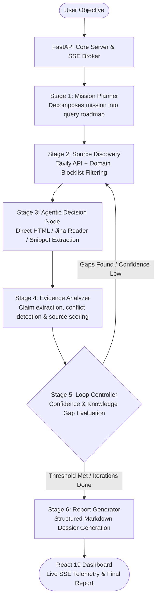

# ⚡ Agent ULTRON — Autonomous AI Investigation Workspace

<div align="center">


<p align="center">
  <b>Autonomous multi-LLM web crawler, cross-verification engine, and enterprise intelligence workspace.</b>
  <br />
  Plans missions, scours the live web, extracts evidence, detects contradictions, and compiles comprehensive intelligence dossiers in real-time.
</p>

</div>

---

## 🌟 Overview

**Agent ULTRON** is an enterprise-grade autonomous AI investigation workspace designed to replace manual research and fragmented OSINT workflows. Given a high-level investigative objective, ULTRON autonomously plans a multi-angle research strategy, interrogates search engines, scrapes content through dynamic extraction nodes, cross-examines claims across diverse sources, detects contradictions, and compiles structured intelligence dossiers.

All agent telemetry, intermediate reasoning chains, and discovered evidence stream to a dark-mode React interface in real time via **Server-Sent Events (SSE)**.

---

## 🚀 Key Features

- **Autonomous 6-Stage Pipeline**: Fully hands-off execution from initial objective decomposition to verified intelligence report generation.
- **Real-Time Telemetry & SSE Stream**: Watch agent thoughts, query execution, content scraping, and confidence score adjustments live on screen.
- **Adaptive Extraction Node (Stage 3)**: Automatically chooses the most effective extraction technique (Direct HTML, Jina Reader markdown extraction, or Tavily snippets) depending on domain type and payload size.
- **Evidence Cross-Verification & Contradiction Detection (Stage 4)**: Deduplicates extracted claims, cross-references conflicting statements across sources, and computes domain authority.
- **Autonomous Loop Controller (Stage 5)**: Detects remaining knowledge gaps and formulates follow-up queries, re-entering search and extraction cycles until confidence thresholds are satisfied.
- **Multi-Model LLM Orchestration**: Combines speed-optimized and deep-reasoning LLMs with built-in automatic model fallback chains to guarantee uptime.
- **Signature UI & Visualizations**:
  - `ConfidenceRing`: Custom radial indicator measuring aggregate investigation confidence and signal lock.
  - `ExecutionPipeline`: Interactive visualization tracking all 6 pipeline phases.
  - `AnimatedRibbon`: 2D canvas dynamic background reacting to current pipeline load.
  - `AuditTimeline`: Fine-grained chronological log of every autonomous action taken by the agent.

---

## 🏗️ Architecture Pipeline



---

## 🧠 Multi-Model LLM Orchestration

Agent ULTRON orchestrates specialized language models across stages with a resilient, automatic fallback cascade:

| Tier | Role / Stage | Primary Model | Purpose |
| :--- | :--- | :--- | :--- |
| **Flash** | Stage 1 (Planner) & Gap Queries | `mistral-small-4` | Ultra-fast planning, task breakdown, structured JSON generation |
| **Reasoning** | Stage 4 (Evidence Analyzer) | `nemotron-3-nano-30b-reasoning` | Deep contextual reasoning, claim conflict detection, gap identification |
| **Super** | Stage 6 (Report Generator) | `nemotron-3-nano-30b` / `nemotron-3-super-120b` | Long-context synthesis, executive summary generation, report formulation |

### Fallback Chain
If an upstream provider encounters rate limits or latency spikes, the client seamlessly shifts down the chain without breaking pipeline execution:
```
mistral-small-4 ➔ nemotron-3-nano-30b ➔ nemotron-3-nano-30b-reasoning ➔ nemotron-3-super-120b ➔ gemini-3.5-flash ➔ minimax-m2.7
```

---

## 📂 Repository Layout

```
ULTRON/
├── backend/
│   ├── Stage_0/            # Core FastAPI server, state machines, and models
│   │   ├── main.py         # Primary API endpoints and SSE stream handler
│   │   ├── models.py       # Pydantic data schemas
│   │   ├── state.py        # InvestigationState class and timeline logic
│   │   ├── requirements.txt # Python dependencies
│   │   └── .env.example    # Backend environment variable template
│   ├── Stage_1/            # Mission planning and LLM integration
│   │   ├── llm_client.py   # Shared LLM client with automatic fallbacks
│   │   ├── planner.py      # Objective breakdown & query planner
│   │   └── prompts.py      # Structured system prompts
│   ├── Stage_2/            # Discovery and Search
│   │   ├── search.py       # Sequential Tavily search execution
│   │   └── utils.py        # Domain blocklist and URL sanitizers
│   ├── Stage_3/            # Scraping and Extraction
│   │   └── extractor.py    # Direct, Jina, and snippet adaptive extractors
│   ├── Stage_4/            # Evidence and Cross-Examination
│   │   └── evidence_analyzer.py # Claim deduplication & contradiction analysis
│   └── Stage_6/            # Final Dossier Synthesis
│       └── report_generator.py  # Markdown report generation
│
└── frontend/               # React 19 + Vite + Tailwind CSS Application
    ├── src/
    │   ├── components/     # UI primitives and investigation dashboards
    │   ├── hooks/          # Custom SSE stream hooks (useInvestigationStream)
    │   ├── pages/          # Home, Dashboard, Investigations, Reports, Settings
    │   ├── services/       # API communication layer
    │   └── types/          # Full TypeScript domain contracts
    ├── package.json
    └── vite.config.ts
```

---

## 🛠️ Quickstart & Installation

### Prerequisites
- **Python 3.10+**
- **Node.js 18+** & **npm**
- **Tavily Search API Key** ([tavily.com](https://tavily.com))
- **OpenAI-compatible / FreeLLM endpoint**

---

### 1. Backend Setup

```bash
# Navigate to the backend directory
cd backend/Stage_0

# Create and activate a Python virtual environment
python -m venv venv
# On Windows:
venv\Scripts\activate
# On Linux/macOS:
source venv/bin/activate

# Install dependencies
pip install -r requirements.txt

# Create your .env file from the example template
cp .env.example .env
```

Edit `backend/Stage_0/.env`:
```ini
TAVILY_API_KEY=tvly-your-tavily-api-key
FREELLM_BASE_URL=http://localhost:3001/v1/chat/completions
FREELLM_API_KEY=your-api-key
```

Run the backend server:
```bash
uvicorn main:app --host 0.0.0.0 --port 8000 --reload
```
The FastAPI documentation will be available at [http://localhost:8000/docs](http://localhost:8000/docs).

---

### 2. Frontend Setup

```bash
# Navigate to the frontend directory
cd frontend

# Install dependencies
npm install

# Start the Vite development server
npm run dev
```

Open [http://localhost:5173](http://localhost:5173) in your browser.

---

## 📡 API Contract & Telemetry Stream

### Primary REST Endpoints

| Method | Endpoint | Description |
| :--- | :--- | :--- |
| `POST` | `/api/investigate` | Initiates a new autonomous investigation task |
| `GET` | `/api/investigations` | Lists all active and completed investigations |
| `GET` | `/api/investigation/{id}` | Fetches current snapshot state of an investigation |
| `GET` | `/api/investigation/{id}/stream` | **Server-Sent Events (SSE)** live telemetry stream |
| `GET` | `/api/investigation/{id}/evidence` | Returns extracted facts and verified source list |
| `GET` | `/api/investigation/{id}/contradictions` | Returns detected conflicts across sources |
| `GET` | `/api/investigation/{id}/metrics` | Returns confidence, coverage, and trust scores |
| `GET` | `/api/investigation/{id}/audit` | Complete event audit log |
| `GET` | `/api/report/{id}` | Fetches generated Markdown intelligence dossier |
| `DELETE` | `/api/investigation/{id}` | Deletes investigation state and cached assets |

### SSE Stream Event Types
The live stream at `/api/investigation/{id}/stream` broadcasts formatted events consumed directly by `useInvestigationStream.ts`:
- `stage` – Current pipeline transition (Stage 0 through 6)
- `timeline` – Human-readable activity item logged in the live feed
- `search` – New search query dispatched to Tavily
- `url` – Discovered or scraped URL status update
- `confidence` – Real-time recalculation of the confidence score (authority & recency metrics)
- `gap` – Identified knowledge gap detected during iteration analysis
- `report` – Final report generation completion signal

---

## 🛡️ License

This project is open-source and available under the MIT License.
